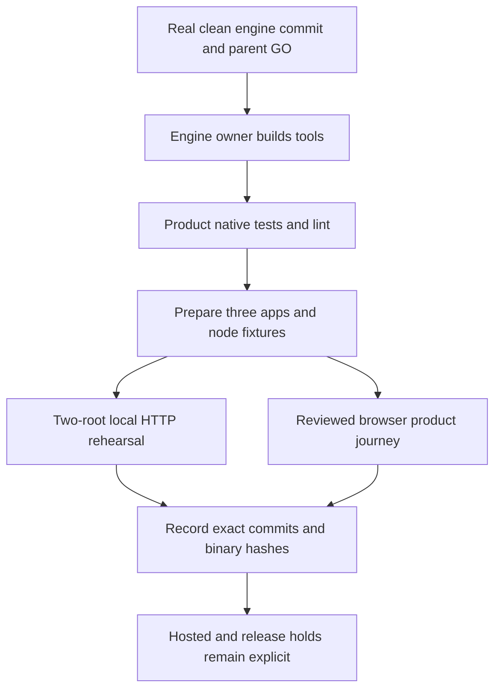

<!-- For God so loved the world, that he gave his only begotten Son, that whosoever believeth in him should not perish, but have everlasting life. - John 3:16 (KJV) -->
# Clone, Build And Journeys Chirho

## Placement And Prerequisites

Clone the clean repositories side-by-side as `cairn-opensource-chirho/` and `perffection-opensource-chirho/`. Cargo's three path dependencies and the product's default `CAIRN_REPO_CHIRHO` use that sibling, never the original private engine. Cairn remains the runtime/auth/storage/effect authority; Perffection remains the three-app Rust/WASM workspace with authored Askama HTML, SCSS and typed page models. There is no Node product server or alternate frontend/auth/storage stack.

Use the committed Rust `1.93.0` toolchain with `rustfmt`, `clippy` and `wasm32-unknown-unknown`; Bash, Python 3 with `tomllib` (3.11+), and SHA-256 tools. The installed engine tree-build tool compiles SCSS. Local HTTP integration additionally needs Caddy, curl and openssl; publication rehearsals need `b3sum` and any prerequisites listed in their script headers. Browser gates use Bun plus installed Chrome and the pinned `tools-chirho/browser-toolchain-chirho/` package. Nothing here authorizes installing a daemon, changing a host, downloading a browser or enabling real provider calls. Font/seal regeneration has optional separate fontTools/Blender/ImageMagick dependencies; ordinary builds reuse authored assets.

## Truthful Version Binding

`CAIRN-PIN-chirho.txt` selects an actual full 40-hex clean-engine commit, after its source import and checks. Build Cairn from that committed source. Pending, dirty or unknown identities must refuse preparation/serve selection. Never substitute the historical private `ffe7ce72...` hash, a fake tag, a false `CAIRN_BUILD_COMMIT_CHIRHO` override or patched `--version` output. Before building, unset inherited `CAIRN_BUILD_COMMIT_CHIRHO` so the engine derives its actual clean Git identity; a dirty build stamp must fail the runtime selector rather than be hidden.

Required CLI format is `cairn-chirho <version> (<actual-clean-engine-commit>)`, using the existing full-commit stamp. Source preparation compares the linked SDK/templating source with the selected commit. Runtime selection validates installed binaries without building, tolerating only the existing documented Markdown-only descendant case. A stamp is consistency metadata, not binary/source attestation: retain executable SHA-256 alongside the engine commit, lockfiles and product source commit at final gates. Candidate journeys require explicit commit/path and, for the reviewed runtime consumer, delivered SHA-256; they are not a silent pin move.

## After Parent Build GO

The initial engine import gate and product build allocation are recorded in readiness. Coordinate future competing builds, serialize engine/product compilation and use only this product's own `target/`; this guide is not a standing resource allocation for a shared machine.

```sh
# From perffection-opensource-chirho:
export CARGO_BUILD_JOBS=2
export CARGO_INCREMENTAL=0
export CARGO_PROFILE_DEV_DEBUG=0
export CARGO_PROFILE_TEST_DEBUG=0
export CARGO_TARGET_DIR="$PWD/target"
mkdir -p "$CARGO_TARGET_DIR/tmp-chirho"
export TMPDIR="$CARGO_TARGET_DIR/tmp-chirho"
export CAIRN_REPO_CHIRHO="$(cd ../cairn-opensource-chirho && pwd)"
export TREE_BUILD_CHIRHO="$CAIRN_REPO_CHIRHO/target/debug/tree-build-chirho"
export CAIRN_CLI_CHIRHO="$CAIRN_REPO_CHIRHO/target/debug/cairn-chirho"

# Engine owner first builds its tree-build-chirho and cairn-chirho tools in its own repository.
# No Perffection invocation of --build-cairn-chirho during this serialized gate.
cargo metadata --locked --offline --no-deps --format-version 1
cargo fmt --all --check
cargo test --locked --workspace -j2
cargo clippy --locked --workspace --all-targets -j2 -- -D warnings
./scripts-chirho/prepare-apps-chirho.sh --app-chirho all
./scripts-chirho/tests-chirho/publication-two-root-rehearsal-chirho.sh
```

The preparation script builds actual release WASM guests, compiles authored SCSS, checks DAG trees, runs nonempty workspace node fixtures and emits source manifests. Its child app WASM links point to the one product workspace target. Missing prepared outputs refuse deployment rather than silently rebuilding. Fresh clones need only the two source repositories and declared tools, not original target artifacts or private history.

```sh
# Development tooling only, from tools-chirho/browser-toolchain-chirho:
bun install --frozen-lockfile --ignore-scripts
bun run check-chirho
bun run test-chirho
# After all three apps are prepared and the exact clean engine stamp is selected:
bun run reviewed-chirho
```

The reviewed browser journey stages/previews source, promotes all three app candidates through the existing engine review mechanism, and exercises sign-in, private save/validation/conflict recovery, publication, republish and rollback. It creates only disposable synthetic local identities and operator test approvals. It does not prove hosted acceptance, real human review, public signup, provider behavior, production money, customer-agent issuance/scopes or complete account recovery. Test artifacts belong in ignored owned scratch/target, not the source distribution.

## Local Product Loop

```sh
./scripts-chirho/dev-serve-tenant-chirho.sh --issue-synthetic-account-chirho
```

After GO this starts the existing two Cairn roots and a loopback Caddy composition. Default edge/public/tenant/admin ports are 8840/8841/8842/8843; set the corresponding `PORT_CHIRHO`, `PORT_PUBLIC_CHIRHO`, `PORT_TENANT_CHIRHO` and `CADDY_ADMIN_PORT_CHIRHO` when occupied. The helper verifies closed registration and prints only owner-private disposable credential file paths. Its stdout gives the local URL. Ctrl-C stops owned processes. No public hostname, signup activation or real credentials are needed. It uses unreviewed-development deployment for UI iteration; use the separate reviewed journey for review-mechanism proof.

Signup browser consumers remain imported test source, not an instruction to run or activate signup in this gate. They explicitly open registration only on their own synthetic local candidate configuration. Public signup, money/provider spending, real email, public webhooks, hosted releases and production visibility stay separately held.


